# QuantumGuard AI
### AI-Powered Anomaly Detection for Quantum Communication Networks

[](backend/tests/)
[](backend/)
[](backend/app/)
[](frontend/)
[](backend/data/)

**QuantumGuard AI** is a software-based research prototype and cybersecurity monitoring application designed to detect, classify, and explain anomalous disturbances in Quantum Key Distribution (QKD) communication channels, with an integrated, segregated **Audio Acoustic Anomaly Detection** module for mechanical/vibration sound analysis.

The application pairs a scientifically consistent **BB84 simulator** with an empirical **baseline calibration engine**, a **tri-engine hybrid anomaly detector** (Rule-Based, Binomial Hypothesis Testing, and Unsupervised Isolation Forest), an **explainable alerting system**, and an **audio acoustic surveillance pipeline** (18-dimensional feature extractor, unsupervised Isolation Forest, and dataset management).


---

## 🚀 Quickstart & Setup Guide

### Prerequisites
- **Python 3.11+** installed (check with `python --version`)
- **Node.js 18+ & npm** (optional — production UI assets are already pre-compiled inside `frontend/dist` and served directly by the backend)

---

### Step 1: Environment Setup & Installation

From the project root:

#### Option A: Using standard Python `venv` and `pip`
```powershell
# 1. Create a virtual environment
python -m venv venv

# 2. Activate the virtual environment
# Windows (PowerShell):
.\venv\Scripts\Activate.ps1
# Windows (CMD):
.\venv\Scripts\activate.bat
# Linux / macOS:
source venv/bin/activate

# 3. Install required Python dependencies
pip install -r requirements.txt
```

#### Option B: Using `uv` (Fastest)
```powershell
uv venv
.\.venv\Scripts\Activate.ps1
uv pip install -r requirements.txt
```

---

### Step 2: Environment Configuration (Optional)
Copy the example environment configuration file:
```powershell
cp .env.example .env
```
*(Default settings automatically bind to `127.0.0.1:8000` with local SQLite storage at `backend/data/quantumguard.db`.)*

---

### Step 3: Launch the Application

#### One-Click Launch (Windows)
Double-click `scripts\run_all.bat` or run:
```powershell
cd scripts
.\run_backend.ps1
```

#### Manual Terminal Command
From the `backend` directory:
```powershell
cd backend
python -m uvicorn app.main:app --host 127.0.0.1 --port 8000
```

Once running, access the application at:
- **Interactive Web Dashboard:** 👉 **[http://127.0.0.1:8000](http://127.0.0.1:8000)**
- **Interactive OpenAPI Documentation:** 👉 **[http://127.0.0.1:8000/docs](http://127.0.0.1:8000/docs)**
- **ReDoc Documentation:** 👉 **[http://127.0.0.1:8000/redoc](http://127.0.0.1:8000/redoc)**

---

### Step 4: Run Automated Tests

To execute the complete 28-test verification suite (BB84 quantum channel, detectors, explainability, benchmark runner, and audio processing):
```powershell
cd scripts
.\run_tests.ps1
```
Or directly with pytest from `backend/`:
```powershell
cd backend
pytest -v
```

---

### Optional: Frontend Development Mode
If you wish to modify the React + TypeScript frontend with hot reload:
```powershell
cd frontend
npm install
npm run dev
```
Open **[http://localhost:5173](http://localhost:5173)** (automatically proxies backend requests to port 8000). To rebuild production static assets:
```powershell
npm run build
```

---

## 🔬 System Architecture

```mermaid
flowchart LR
    A[Alice State Prep] --> B[Quantum Channel]
    B -->|Photon Loss & Noise| E[Eve Intercept-Resend]
    E --> C[Bob Measurement]
    C --> D[Sifting & Parameter Estimation]
    D --> F[Observable Features & Wilson CI]
    F --> G[Calibrated Baseline]
    F & G --> H[Tri-Engine Hybrid Detector]
    H --> I[Explainable Security Alerts]
    I --> J[(SQLite Persistence)]
    J --> K[Interactive Dashboard]
```



### Key Modules:
- **`backend/app/simulator/`**: Modular BB84 simulation engine implementing Alice bit/basis generation, MUB state space, Poisson/Bernoulli photon loss, depolarizing channel noise, Eve intercept-resend attack, Bob measurement, public sifting, parameter estimation, and candidate raw key distillation.
- **`backend/app/analytics/features.py`**: Extracts observable telemetry while strictly preventing ground-truth data leakage.
- **`backend/app/analytics/baseline.py`**: Empirically calibrates channel baselines and dynamic confidence thresholds from reference runs.
- **`backend/app/analytics/detectors/`**:
  - `rule_based.py`: Deterministic boundary checks (Shor-Preskill 11% threshold, sample size warnings, physical data validity).
  - `statistical.py`: Continuity-corrected binomial $z$-test hypothesis testing against baseline error distributions.
  - `ml_detector.py`: Scikit-learn Isolation Forest unsupervised outlier scorer trained strictly on reference baseline vectors.
  - `hybrid.py`: Multi-engine consensus fusion.
- **`backend/app/analytics/alerts.py`**: Multi-hypothesis explainable security alerts detailing observed metrics, baseline bounds, 95% Wilson confidence intervals, alternative plausible physical causes, and recommended operator investigation steps.
- **`backend/app/analytics/evaluation.py`**: Independent benchmark runner evaluating all detectors simultaneously across held-out scenarios.
- **`frontend/`**: Responsive React + TypeScript + Vite + Tailwind CSS + Recharts cybersecurity dashboard.

---

## 📐 Scientific & Mathematical Foundations

### 1. Intercept-Resend Error Rate Derivation
In an ideal BB84 channel where Eve intercepts pulses with probability $p_{eve}$ and measures in a randomly selected basis before resending:
- Probability Eve chooses Alice's basis = $0.5 \implies$ Bob receives Alice's state $\implies$ Error rate = $0.0\%$.
- Probability Eve chooses conjugate basis = $0.5 \implies$ Bob receives state in unbiased basis $\implies$ Error rate = $50.0\%$.
- Expected QBER on the sifted key:
  $$\mathbb{E}[\text{QBER}] = p_{eve} \times (0.5 \times 0.0 + 0.5 \times 0.5) = 0.25 \times p_{eve}$$
  For full intercept-resend ($p_{eve} = 1.0$), the expected QBER is **25.0%**.

### 2. Physical Decoupling of Photon Loss
In QuantumGuard AI, photon attenuation represents **missing detections at the receiver**, not artificial bit flips. If a channel experiences 80% loss with 0% noise, Bob detects 20% of photons, and QBER remains strictly **0.0%**.

### 3. Wilson Score Interval for Finite-Key Uncertainty
To prevent false security claims on small samples, observed error rates are framed with the Wilson score interval:
$$\tilde{p} = \frac{k + \frac{z^2}{2}}{n + z^2}, \quad \text{margin} = \frac{z}{n + z^2}\sqrt{\frac{k(n - k)}{n} + \frac{z^2}{4}}$$
If $n < 30$, the system explicitly returns `INSUFFICIENT DATA`.

---

## 🎯 10 Standard Simulation Scenarios

| # | Scenario Name | Eve Tap ($p_{eve}$) | Noise ($p_{noise}$) | Loss ($p_{loss}$) | Expected Behavior |
|---|---|---|---|---|---|
| 1 | Ideal Normal Channel | 0% | 0.0% | 0% | QBER = 0.0%, 100% detection rate |
| 2 | Operational Background Noise | 0% | 1.5% | 12% | Typical telecom fiber reference baseline |
| 3 | Elevated Channel Noise | 0% | 9.5% | 12% | Environmental thermal drift (QBER ~ 9.5%) |
| 4 | Severe Photon Attenuation | 0% | 1.5% | 85% | Macro-bending loss; QBER remains ~1.5% |
| 5 | Partial Intercept-Resend | 35% | 1.0% | 10% | Subtle attack (QBER ~ 9.7%) |
| 6 | Full Intercept-Resend | 100% | 0.5% | 10% | Severe attack (QBER ~ 25.0%), exceeds 11% limit |
| 7 | Combined Disturbance | 50% | 3.5% | 45% | Compound multi-factor optical impairment |
| 8 | Insufficient Sample Size | 0% | 2.0% | 80% | $N=45$; flags `INSUFFICIENT DATA` |
| 9 | Robustness Test A (Unseen) | 18% | 1.2% | 28% | Held-out novel generalization benchmark |
| 10 | Robustness Test B (Unseen) | 0% | 2.8% | 38% | Benign optical drift; tests false positive control |

---

## 🔊 Audio Anomaly Detection Module

QuantumGuard AI includes a dedicated, structurally segregated **Audio Anomaly Detection** subsystem designed for acoustic vibration analysis and acoustic defect inspection:

### Core Capabilities:
- **Audio Ingestion & Validation:** Accepts single or batched uncompressed WAV audio files (up to 50 MB) and structured ZIP archives with automated directory-based categorization (`normal` vs `anomalous`).
- **Interactive Player & Waveform Visualizer:** In-browser audio streaming (`/api/audio/files/{id}/stream`) and 120-bin downsampled normalized waveform envelope visualization.
- **18-Dimensional Acoustic Feature Extraction:** Computes physical sound parameters via `librosa` and `soundfile`:
  - **RMS Energy:** Signal amplitude / physical power.
  - **Zero-Crossing Rate (ZCR):** High-frequency noisiness and sign alternation rate.
  - **Spectral Centroid, Rolloff, & Bandwidth:** Spectral brightness and energy distribution in Hertz.
  - **13 Mel-Frequency Cepstral Coefficients (MFCCs):** Timbral texture and spectral envelope.
- **Unsupervised Isolation Forest Detector:** Trained exclusively on verified reference *Normal* audio samples. Employs multidimensional decision scoring combined with continuous standard-deviation excursion diagnostics ($z$-scores) to deliver explainable verdicts and outlier scores ($[0.0, 1.0]$).
- **Dataset Management & Evaluation:** Aggregated inventory statistics, category filtering, model retraining, threshold adjustment, ground-truth evaluation (Accuracy, Precision, Recall, F1, Confusion Matrix), and one-click CSV report export.
- **Curated Benchmark Resources:** In-app reference cards and links to leading open datasets:
  - [MIMII (Zenodo)](https://zenodo.org/records/3678171): Industrial machine sound (valves, pumps, fans, rails).
  - [ToyADMOS (GitHub)](https://github.com/YumaKoizumi/ToyADMOS-dataset): Miniature machine acoustic anomaly challenge.
  - [FSD50K (Freesound)](https://fsannotator.upf.edu/fsd/downloads/): 50K human-labeled environmental sound events.

> [!NOTE]
> **Strict Architectural Separation:** Audio acoustic features are strictly isolated from the BB84 quantum communication simulator and optical QBER calculations. Acoustic vibration datasets are never conflated with quantum optical channel telemetry.

---

## 🧪 Automated Test Suite

Execute all 28 automated unit and integration tests:
```powershell
cd scripts
.\run_tests.ps1
```

### Verified Test Categories:
- **`test_bb84_simulator.py`**: Ideal channel zero QBER, full intercept-resend 25% theoretical convergence, partial eavesdropping, photon loss decoupling, zero-sample `None` handling, seed reproducibility, Wilson score intervals.
- **`test_baseline_calibration.py`**: Empirical distribution aggregates, small-sample warnings, sensitivity multipliers.
- **`test_detectors.py`**: Shor-Preskill threshold excursions, binomial $z$-test hypothesis testing, small-sample safeguards, Isolation Forest outlier fitting.
- **`test_alerts_explainability.py`**: Evidence-based alert structures, multi-hypothesis alternative causes, scientific disclaimers.
- **`test_evaluation.py`**: Data leakage prevention, confusion matrix mathematics, multi-scenario benchmark execution.
- **`test_api.py`**: FastAPI endpoints, input validation rejection, database transaction safety.
- **`test_audio.py`**: WAV header validation, acoustic feature extraction (RMS, ZCR, Centroid, MFCCs), Isolation Forest training and threshold predictions, ZIP extraction security, API upload, playback streaming, and dataset aggregation.


---

## 📚 Documentation Links
- [Detailed Architectural Specification](docs/ARCHITECTURE.md)
- [Scientific & Statistical Validation Report](docs/SCIENTIFIC_VALIDATION.md)
- [College Faculty & SIH Judge Demonstration Guide](docs/DEMO_GUIDE.md)

---

## ⚖️ Scientific Disclaimer & Scope Limitations
1. **Simulation Scope:** QuantumGuard AI is a software simulation and research prototype. It does not interface directly with physical single-photon detectors or real-world quantum optical hardware.
2. **Post-Processing Scope:** In real-world QKD, candidate keys must undergo error correction (e.g. CASCADE or LDPC), privacy amplification (universal hashing), and authenticated classical communication. These protocols are outside the scope of this channel-monitoring prototype.
3. **No Definitive Attack Proof:** In accordance with physical quantum mechanics, physical channel noise (thermal fluctuations, detector dark counts) produces error statistics that can be indistinguishable at the physical layer from eavesdropping. QuantumGuard AI highlights alternative hypotheses and never makes unfounded claims of definitive attack proof.
