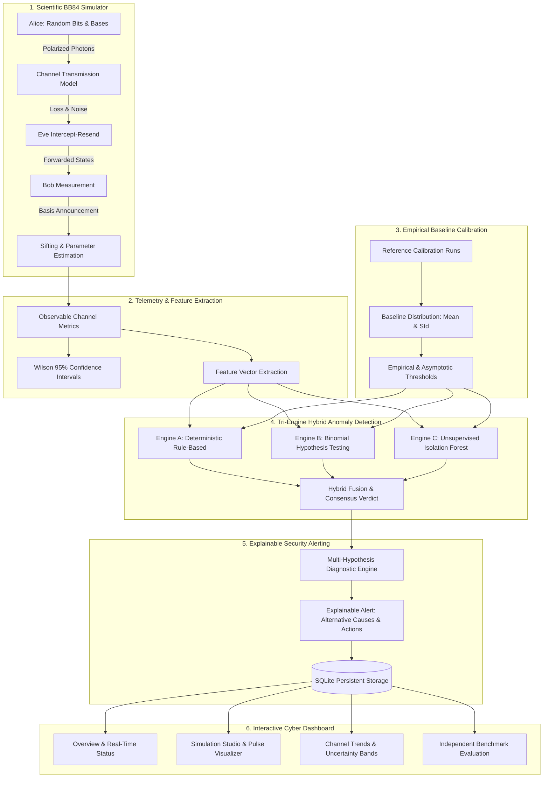

# QuantumGuard AI — Architectural Specification

## 1. System Overview

**QuantumGuard AI** is a modular software prototype for quantum communication channel surveillance, anomaly detection, and explainable cybersecurity alerting.

---

## 2. BB84 Quantum Communication Protocol & Physics

### A. Alice State Preparation
Alice generates random bits $b_A \in \{0, 1\}$ and randomly chooses between two mutually unbiased bases (MUB):
- **Rectilinear Basis ($+$)**:
  - Bit $0 \to |0\rangle$ (Horizontal polarization)
  - Bit $1 \to |1\rangle$ (Vertical polarization)
- **Diagonal Basis ($\times$)**:
  - Bit $0 \to |+\rangle = \frac{|0\rangle + |1\rangle}{\sqrt{2}}$ ($+45^\circ$)
  - Bit $1 \to |-\rangle = \frac{|0\rangle - |1\rangle}{\sqrt{2}}$ ($-45^\circ$)

### B. Channel Attenuation (Photon Loss Model)
Photon loss occurs with probability $p_{loss} \in [0, 1]$ (e.g. from optical fiber absorption or detector inefficiency).
- **Correctness Guarantee:** Photon loss represents missing detections at Bob, **never** an automatic bit error.
- If a photon is lost, Bob registers no detection (`detection = False`), and no measurement is made.

### C. Eve's Intercept-Resend Attack Model
Eve intercepts individual pulses with probability $p_{eve} \in [0, 1]$.
- Eve selects measurement basis $B_E \in \{+, \times\}$ with probability 0.5.
- If $B_E == B_A$: Eve deterministically acquires Alice's bit ($b_E = b_A$).
- If $B_E \ne B_A$: Eve measures in the conjugate basis, obtaining outcome 0 or 1 with 50/50 probability.
- Eve prepares a replacement photon in state $(B_E, b_E)$ and re-transmits it to Bob.

#### Theoretical Expected QBER Derivation:
For sifted pulses (where Alice and Bob used the same basis):
1. Eve chose matching basis (probability 0.5):
   - Eve's state matches Alice's original state.
   - Bob measures in Alice's basis $\implies$ Bob always gets Alice's bit. Error probability = 0.
2. Eve chose non-matching basis (probability 0.5):
   - Eve prepares state in the conjugate basis.
   - Bob measures in Alice's basis $\implies$ Bob gets 0 or 1 with equal probability. Error probability = 0.5.
3. Total expected error given Eve intercepts:
   $$P(\text{error} \mid \text{sifted}, \text{Eve}) = (0.5 \times 0.0) + (0.5 \times 0.5) = 0.25 = 25\%$$
4. Across all pulses where Eve intercepts with probability $p_{eve}$:
   $$\mathbb{E}[\text{QBER}] = 0.25 \times p_{eve}$$
   When $p_{eve} = 1.0$ (Full Intercept-Resend), the theoretical expected QBER is **25.0%**.

### D. Parameter Estimation & Key Sifting
1. **Sifting**: Keep pulses where Bob detected a photon AND Alice's basis equals Bob's basis ($B_A == B_B$).
2. **Estimation**: Randomly disclose a fraction $\alpha_{test}$ of sifted bits.
3. **QBER Calculation**:
   $$\text{QBER} = \frac{N_{errors}}{N_{test}}$$
   If $N_{test} == 0$, QBER is marked **unavailable (`None`)**, never fabricated as zero.
4. **Statistical Uncertainty (Wilson Score Interval)**:
   $$\tilde{p} = \frac{k + \frac{z^2}{2}}{n + z^2}, \quad \text{margin} = \frac{z}{n + z^2}\sqrt{\frac{k(n - k)}{n} + \frac{z^2}{4}}$$
   Provides a rigorous 95% confidence interval $[CI_{lower}, CI_{upper}]$.

---

## 3. Tri-Engine Hybrid Anomaly Detection

### Engine A: Rule-Based Deterministic Boundary Check
- **Data Validity**: Asserts probabilities $\in [0, 1]$.
- **Insufficient Sample Warning**: If $N_{test} < 30$, flags `INSUFFICIENT DATA` to prevent false confidence.
- **Shor-Preskill Security Threshold**: If $\text{QBER} \ge 11.0\%$, secret key distillation is theoretically impossible for standard BB84; triggers `INVESTIGATION REQUIRED`.
- **Baseline Excursion**: If $\text{QBER} > \text{Baseline Threshold}$, triggers `ANOMALY SUSPECTED`.
- **Loss / Detection Shift**: Flags abrupt fiber attenuation spikes.

### Engine B: Statistical Hypothesis Testing (Binomial Z-Test)
- Null Hypothesis $H_0: p \le p_0$ (Channel operating at baseline error rate $p_0$).
- Alternative Hypothesis $H_1: p > p_0$ (Elevated channel disturbance).
- Continuity-corrected test statistic:
  $$z = \frac{(k - n p_0) - 0.5}{\sqrt{n p_0 (1 - p_0)}}$$
- Computes exact $p$-value from standard normal survival function $p = 1 - \Phi(z)$.
- Rejects $H_0$ at significance level $\alpha = 0.01$ (99% confidence).

### Engine C: Unsupervised Machine Learning (Isolation Forest)
- Features: `[QBER, Detection Rate, Loss Rate, Sifted Ratio, CI Width, Sample Flag, QBER Delta, QBER Z-Score, Detection Delta, Loss Delta]`.
- Trained **strictly** on reference baseline data (clean/operational runs).
- Generates multidimensional isolation score $[0, 1]$.
- **Scientific Limitation**: Clearly documented as an outlier isolation distance, **not** the objective probability of an attack.

---

## 4. Multi-Hypothesis Explainable Alerting
When an anomaly is flagged, QuantumGuard AI does **not** jump to an unsupported conclusion of an attack. It generates an explainable security alert containing:
1. Observed metrics vs calibrated baseline bounds.
2. 95% Wilson confidence interval.
3. Multiple plausible alternative causes:
   - Thermal dark counts in Single Photon Avalanche Photodiodes (SPADs).
   - Fiber optic macro-bending or mechanical stress.
   - Laser polarization drift or optical misalignment.
   - Potential intercept-resend eavesdropping by an adversary.
4. Concrete recommended next steps for operator investigation.
5. Traceable link back to source simulation run in SQLite.
